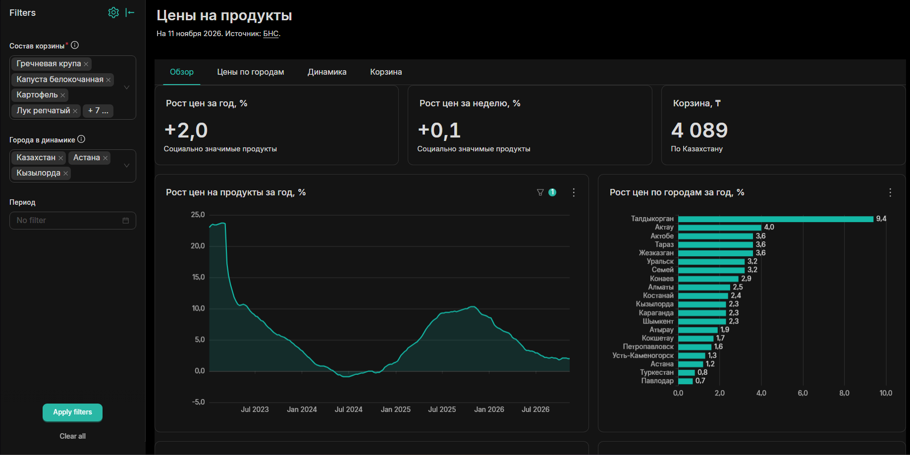
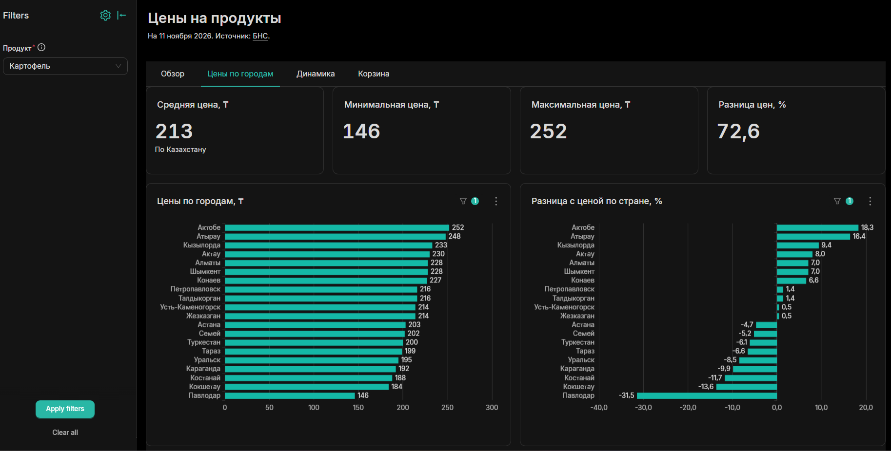
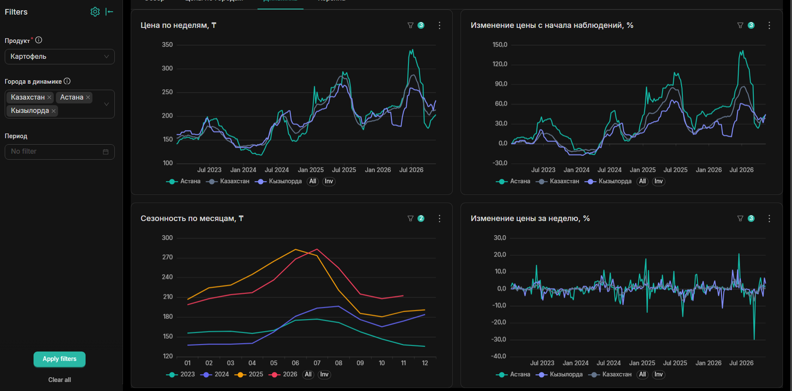

# prices-etl

Стенд анализа цен на социально значимые продукты в Казахстане.
Данные Бюро национальной статистики: 202 недельных выпуска за 04.01.2023–11.11.2026, 382 958 наблюдений цен и индексов.




## Стек

- Python: requests, xlrd, openpyxl, clickhouse-connect.
- ClickHouse 26.8: данные и SQL-витрины.
- Superset 6.0.0 lean: дашборд и фильтры. Метаданные — SQLite.
- Docker Compose: два контейнера. Python ETL запускается на хосте.

## Обработка

`БНС → XLS/XLSX → Python → JSONL → ClickHouse → Superset`

1. Скачать оригиналы в `data/raw`. 
2. Разобрать таблицы, привести названия, даты и числа к единому виду.
3. Проверить дубли и значения. Загрузить временную таблицу пакетами по 20 000 строк.
4. Атомарно заменить активную таблицу через `EXCHANGE TABLES`.
5. Создать SQL-витрины, датасеты, фильтры и графики Superset.

Ключ наблюдения: дата × город × спецификация продукта × показатель.
Пропуски сохраняются как NULL. У записи остаются файл, лист и координаты исходной ячейки.

## Запуск

Нужны Python 3.10+, Docker Desktop с Linux containers и локальный образ `clickhouse/clickhouse-server:26.8`.

```powershell
.\scripts\run.ps1
```

Повторная обработка без скачивания:

```powershell
.\scripts\run.ps1 -SkipDownload
```

[Дашборд](http://localhost:18088/superset/dashboard/food-price-observatory/?standalone=2).
Логин `admin`, пароль — `SUPERSET_ADMIN_PASSWORD` в `.env`.
ClickHouse доступен на `localhost:18123`. Данные обоих сервисов хранятся в Docker volumes.

## Дашборд

Четыре вкладки: обзор, цены по городам, динамика и корзина.
Состав корзины меняется фильтром «Состав корзины», затем кнопкой Apply filters.
Каждый выбранный продукт берётся в одной опубликованной единице: кг, л или 10 яиц.
Стоимость считается только при наличии всех выбранных позиций.

## Основные файлы

- `etl/download.py`, `etl/parse.py`, `etl/load.py` — скачивание, разбор и загрузка.
- `sql/views.sql` — витрины ClickHouse.
- `superset/bootstrap.py`, `superset/config/` — сборка и настройки дашборда.
- `superset/config/basket.sql` — расчёт выбранного состава корзины.
- `data/processed/quality_report.json` — отчёт по данным.

